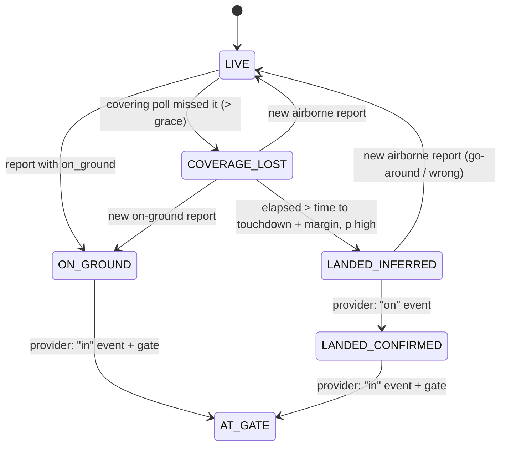

# Coverage-gap inference: progress

This file is the single source of truth for the coverage-gap work: what
"probably landed" becomes when ADS-B coverage is lost. To resume a session,
say "Resume the coverage-gap work from docs/agents/PROGRESS.md". Then read
this file, check the branch state (`git log` on the branches below), and
continue from **Next task**.

## Status

- **Current phase:** done, apart from the human's checkpoints. All PRs are open and wait for human review and merge, in order: #120, #121, #122, #124, #125. #123 (CLAUDE.md rules) is independent.
- **Next task:** keep #120–#125 green. Once the human adds `SWEDAVIA_API_KEY` / `AERODATABOX_API_KEY`, check the open items in `docs/agents/swedavia-api.md` and `aerodatabox-api.md` live and replace the reconstructed fixtures. The backlog has route search. Phase 4 is training the model once labels accumulate.
- **Blocked on the human:** the Phase 3 provider choice (see `provider-research.md`). Phases 1 and 2 continue meanwhile.

## Working agreements (from the human, 2026-10-12)

The most important rule: **the code is always safe on origin.**

1. **Push for safekeeping, but never a commit you know will fail.** `build-deploy.yml` runs only on pull requests and on pushes to `main`, so where you push decides whether CI runs.
   - **Expected to pass** (fast local checks green): push to the PR branch, and CI runs.
   - **Known broken or half-done:** push to a branch with no PR (`wip/<topic>`, e.g. `wip/coverage-gap-provider`). It is backed up on origin with no CI run. Move it to the PR branch once it passes the fast checks.
2. **Offload testing to GitHub Actions, without overloading it.** Locally, run only the fast checks for what changed: typecheck/build, plus the changed backend test class or Playwright spec. Then push and let CI run the full suites (e2e, perf, scenarios, backend, blackbox).
   - Push to a PR branch once per logical unit of work, not once per edit. Each push to an open PR starts a ~12 min run and cancels the one before it.
   - A progress-only update to this file rides along with the next code push when one is coming soon. Otherwise push it on its own: one run is fine, a burst of them is not.
3. **Never merge unless CI is green.** Agents never merge; the human does.
4. CI notification emails are off on the human's side.

## Branches and PRs

| Phase | Branch | Based on | PR |
|---|---|---|---|
| 1 | `claude/beautiful-thompson-afahki` | `main` | [#120](https://github.com/petterfranzen/flight-tracker/pull/120) |
| 2 | `claude/coverage-gap-phase2` | phase 1 branch (stacked) | [#121](https://github.com/petterfranzen/flight-tracker/pull/121) |
| 3 | `claude/coverage-gap-phase3` | phase 2 branch (stacked) | [#122](https://github.com/petterfranzen/flight-tracker/pull/122) |
| 3b | `claude/coverage-gap-phase3b-swedavia` | phase 3 branch (stacked) | [#124](https://github.com/petterfranzen/flight-tracker/pull/124) |
| 3c | `claude/coverage-gap-phase3c-aerodatabox` | phase 3b branch (stacked) | [#125](https://github.com/petterfranzen/flight-tracker/pull/125) |
| wip | `wip/coverage-gap-phase3b`, `wip/coverage-gap-phase3c`, `wip/route-search-brief` | no PR, no CI | safekeeping |

The brief asks for one PR per phase. The later phases build on the earlier
ones, so the branches are stacked, and each PR targets the previous phase's
branch. Never merge to `main`; the human merges.

## Tasks

| ID | Task | Agent | Depends on | Status |
|---|---|---|---|---|
| P0 | Reconnaissance: code map | explorer | none | done |
| P3-R | Research confirmation providers (web): `docs/agents/provider-research.md` | explorer | none | done; awaiting human choice |
| P1-A | Runway data: bundled `runways.tsv`, `runway` table, seed, in-memory `RunwayIndex` | implementer | none | done (fce7e86): 16,520 directional runways, 706 KB TSV, 13 tests |
| P1-B | Pure `CoverageGapEstimator` (Kalman/dead reckoning, runway match, time to touchdown, landed probability) and scenario unit tests | implementer | none | done (a84c0a9): 15 scenario tests |
| P1-C | Backend wiring: poll-coverage tracker, `EstimatorAgent` on the new estimator, `TrackStatus` on `LiveAircraft`, `GET /api/flights/{icao24}/status`, dossier text | implementer | P1-A, P1-B | done (cd685da, 3bf639a, 636bbf7): backend 179 tests, blackbox 23/23 |
| P1-D | Frontend: status line with confidence and source, uncertainty cone GL layer, status polling, Playwright tests | implementer | contract below | done (a9c2ab9): 13 new Playwright tests |
| P1-R | Review Phase 1: diff, all quality gates, check against the brief | reviewer | P1-C, P1-D | done: no blockers, 4 should-fix (`reviews/phase1.md`) |
| P1-F | Fix the P1-R should-fix items 1–4 and nits 5, 6, 7, 10, 11, 12 | implementer | P1-R | done: all fixed, 188 backend tests, e2e 118/118 |
| P2 | Training data capture: tables, capture and label service, retention, `LandingModel` stub (plan below) | implementer | Phase 1 | done (801b70e on `claude/coverage-gap-phase2`): 198 backend tests |
| P3 | Provider SPI, framework-level cache and rate limit, `ConfirmationStore`, upgrade service, mock provider, UI tweaks (no real provider) | implementer | Phase 2 | done (4d52beb, 2aaefff on `claude/coverage-gap-phase3`): backend 252 tests, coverage-status 15/15 |
| P3-R | Review Phases 2 and 3 | reviewer | P1-F merged forward | done: no blockers (`reviews/phase2-3.md`) |
| P2-F | Phase 2 fixes: capture delay, long-gap labels, flush retry, schema `;` | implementer | P3-R | done (99af1b9, 8b82130): 214 backend tests |
| P3-F | Phase 3 fixes: stale cache, gate re-poll cap, Retry-After cap, pool, refetch, docs | implementer | P3-R | done (cd6b2ad, b7abeaf, ffa4371, facdea8). The agent hit the session usage limit during its final e2e run, after committing everything; the orchestrator verifies the gates |
| P3-real | Real provider (the human chooses) | | | the human chose Swedavia first, AeroDataBox second |
| P3b-R | Swedavia FlightInfo v2 contract: endpoints, auth, schema, status codes, ActualUtc semantics, limits | explorer | none | done: `docs/agents/swedavia-api.md` |
| P3b-1 | Framework: `AirportArrivalsProvider` (board per airport and date), board cache, callsign/registration matching, per-provider daily/monthly budgets in units persisted in `app_state` | implementer | none | done (06eff75): 323 tests |
| P3b-F | Fix the P3b review findings (budget fail-closed, key lockout, recheck memo, skipped fetch, DST tests, docs) | implementer | P3b-Rev | done: 367 tests, pushed to #124 |
| P3b-2 | `SwedaviaArrivalsProvider` + fixtures + config (`SWEDAVIA_API_KEY` env var, `deploy/hetzner/env.example`, README) | implementer | P3b-R, P3b-1 | done (65feb87, f99edf1): 354 tests; **PR #124** |
| P3b-Rev | Review Phase 3b | reviewer | P3b-2 | done: no blockers (`reviews/phase3b.md`) |
| P3c-R | AeroDataBox contract | explorer | none | done: `docs/agents/aerodatabox-api.md` |
| P3c-1 | `AeroDataBoxArrivalProvider` (nearest-flight lookup, 2 units/call, 380/month, 14/day, precedence after board providers, no training labels by default) | implementer | P3c-R | done |
| P3c-2 | Provider credit link in the dossier status line (AeroDataBox terms ¶5.4) | implementer | P3c-R | done |
| P3c-Rev | Review Phase 3c | reviewer | P3c-1, P3c-2 | done: budget-waste findings (`reviews/phase3c.md`) |
| P3c-F | Fix the P3c findings: per-provider recheck (30 min/3 h), no gate wait, `accepts()` pre-check, 4xx → NOT_FOUND, refunds, selection, display names | implementer | P3c-Rev | done: 437 tests; **PR #125** |
| R | `CLAUDE.md` pushing, CI and merging rules (from the working agreements) | orchestrator | none | PR #123 |

## Phase 0 findings (summary)

- **"Probably landed" is not one place.** `AircraftController.describeLikelyStatus`
  builds the text, which is `staleExplanation` on the dossier. `presumedLanded`
  is computed per request: phase DESCENDING or LANDING and silent for more than 30 min.
  The dossier panel shows it after 10 minutes of silence.
- **Why planes freeze.** `EstimatorAgent` takes the destination from the legacy
  `aircraft.destination_*` columns, which are now always null, so
  `EstimatedPositionService` returns no estimate. When there is one, it
  dead-reckons to the destination point and parks there. It has no
  uncertainty, no altitude or vertical rate, and no landing concept.
- **No runway data.** `airports.tsv` (OurAirports, 7 columns) has no runways
  and no elevation. OurAirports `runways.csv` is public domain and reachable.
- **Schema** is `schema.sql`, which runs on every boot. There are no migrations, so new
  tables use `CREATE TABLE IF NOT EXISTS` and nothing uses `ALTER`.
- **Existing partial confirmation.** `OpenSkyFlightsClient.confirmLanded` and
  `aircraft.landing_confirmed_at` exist. This becomes the first real provider
  in Phase 3.
- **Wire formats.** The selected plane polls `GET /api/flights/{icao24}/live`
  (a `FlightPosition`) every 72 s. `LiveFrame` (WebSocket) carries marker fields only.
- **Clock.** New code injects `Clock`. `EstimatorAgent` uses `Instant.now()` today.

## Decisions

1. **Coverage lost is measured against polls, not wall time alone.** The
   global sweep refreshes most aircraft only every 6 min, so a silence
   threshold alone would flag every swept aircraft between sweeps.
   `AgentOrchestrator` records each successful poll (time and bounds; the
   global sweep covers the world) in a `PollCoverageTracker`. An aircraft
   is in a gap when a poll that covered its last position completed more
   than `flighttracker.coverage.gap-grace-seconds` (default 60) after its
   last report.
2. **State model.** One enum, `TrackState`, with
   `LIVE, COVERAGE_LOST, LANDED_INFERRED, ON_GROUND, LANDED_CONFIRMED, AT_GATE`.
   Every state also carries a `confidence` (0..1), a `source`
   (`adsb`, `physics`, `model`, or a provider id), and a `sourceKind`
   (`observed`, `inferred` or `confirmed`). Phase 1 produces the first four. The confirmed
   states are reserved for Phase 3. A confirmation is monotonic: a later
   estimate never downgrades it. A new real report resets everything to
   observed states, the same as estimates are cleared today.
3. **Estimator.** A pure function over a fixed snapshot of the last
   reports, the nearby runways, the destination and the current time. While
   an aircraft is silent its inputs don't change, so the snapshot (the last
   ~10 min of positions) is read from `flight_position` once, when the gap
   begins, and cached per `(icao24, observedAt)`. The background estimator
   runs only over aircraft in a gap.
4. **Uncertainty.** The estimator returns an estimated position and a 95%
   radius. The UI draws a cone: the convex hull of the last-seen point and
   the circle around the estimate. After the inferred touchdown, the estimate
   parks on the runway and the radius shrinks to the airport scale.
5. **Transport.** There is a new endpoint, `GET /api/flights/{icao24}/status`
   (contract below). `FlightPosition`, `/live`, `/history`, `LiveFrame` and
   `LiveMarker` stay unchanged. Markers keep using the existing display-position
   mechanism. A coverage-lost plane moves along its dead-reckoned position,
   and an inferred-landed plane is drawn at the runway.
6. **Runway data.** A trimmed OurAirports `runways.tsv` is bundled next to
   `airports.tsv` (only airports in `airports.tsv`, only open runways with
   threshold coordinates). It goes into a new `runway` table and is held in
   memory as a grid-bucketed `RunwayIndex`. The shared record is
   `service/coverage/Runway.java`, one row per landing direction.
7. **Package.** The new backend code goes in `com.flighttracker.service.coverage`.

## Contract: `GET /api/flights/{icao24}/status`

The response is 200 with the JSON below, or 404 when the aircraft is not in the live set.

```json
{
  "icao24": "4ca123",
  "state": "COVERAGE_LOST",
  "confidence": 0.85,
  "source": "physics",
  "sourceKind": "inferred",
  "lastSeenAt": "2026-10-12T11:00:00Z",
  "lastSeenLat": 59.60,
  "lastSeenLon": 17.90,
  "estimate": {
    "lat": 59.65,
    "lon": 17.93,
    "radiusM": 1800,
    "at": "2026-10-12T11:02:00Z",
    "landingProbability": 0.40
  },
  "landing": {
    "airportIcao": "ESSA",
    "runway": "19R",
    "touchdownAt": "2026-10-12T11:03:10Z"
  },
  "gate": null,
  "terminal": null,
  "confirmedAt": null
}
```

- `state` is one of `LIVE | COVERAGE_LOST | LANDED_INFERRED | ON_GROUND | LANDED_CONFIRMED | AT_GATE`.
- `confidence` is the confidence in `state` (0..1). It is null for `LIVE`.
- `source` is `adsb | physics | model | <provider id>`.
- `sourceKind` is `observed | inferred | confirmed`.
- `estimate` is null unless the state is `COVERAGE_LOST` or `LANDED_INFERRED`. `radiusM` is the ~95% horizontal radius, and `at` is the time the estimate was computed.
- `landing` is null when no runway or airport candidate was found. `touchdownAt` is the predicted time while `COVERAGE_LOST`, and the inferred time once `LANDED_INFERRED`.
- `gate`, `terminal` and `confirmedAt` are filled from Phase 3 on (`confirmedAt` is the actual "on" or "in" time).

UI labels (the dossier status line):

| state | label |
|---|---|
| LIVE | (no status line) |
| COVERAGE_LOST | `Coverage lost · est. ±1.8 km` (+ ` · landing ~11:03 ESSA 19R` when `landing`) |
| LANDED_INFERRED | `Landed 92% (inferred) · ESSA 19R` |
| ON_GROUND | `On ground (ADS-B)` |
| LANDED_CONFIRMED | `Landed (confirmed · <source>)` |
| AT_GATE | `At gate B14 (confirmed)` |

The frontend fetches the status when a plane is selected and on every
selected-plane poll. While the state is `COVERAGE_LOST`, it refetches every 15 s,
so the cone grows.



## Phase 2 plan (training data capture)

- Add `CREATE TABLE IF NOT EXISTS track_end_feature` (one compact row per
  track end, keyed `(icao24, last_observed_at)`, with no foreign keys to
  `aircraft` or `flight_position`). It denormalises callsign, origin and destination,
  the last-report kinematics, the runway features, and the estimator output
  and version. Add a `track_end_label` table (outcome, label source, time).
- Capture happens when the estimator first sees a gap (the snapshot is already in
  hand). The label is written when coverage resumes (on ground or airborne)
  or when a provider confirms.
- Retention: `flighttracker.training.retention-days` (default 365), pruned in
  `PositionRetentionService` without touching the 72 h position rule.
- Add a `LandingModel` interface stub (`predict(features) -> Optional<prob>`) that
  the estimator consults. The default no-op bean returns empty.

## Phase 3 plan (confirmation)

- Add a `ConfirmationProvider` interface (`@Component`s collected as a list):
  lookups return OOOI times and gate/terminal with a status enum
  (FOUND/NOT_FOUND/THROTTLED/FAILED). Calls are cached and rate limited
  through `PollBackoff` plus a minimum interval.
- Add a mock provider (disabled by default) and an upgrade service that turns
  inferred or observed states into `LANDED_CONFIRMED`/`AT_GATE` and writes
  the Phase 2 label.
- **Checkpoint:** the human chooses a real provider from the research before
  one is implemented.

## Backlog (from the human)

- **Route search, e.g. London → Barcelona.** The brief is ready: `docs/agent-tasks/route-search.md` on branch `wip/route-search-brief` (no PR yet). It extends the existing origin-OR-destination airport search with `from`/`to`. Start it when the human says so.

## Open questions

- **For the human (AeroDataBox terms):** the free Basic plan is **non-commercial** only and requires visible attribution. That is built in.
  It also allows caching data for **at most 7 days**. So, by default, AeroDataBox-confirmed landings are not written into the 365-day training labels (`flighttracker.confirmation.aerodatabox.record-training-labels=false`). Pro ($8/month) allows commercial use, but the 7-day rule still applies.

- **For the human:** training-data volume. **Measured live: about 70k rows/day, about 20 MB/day, about 7 GB/year at 365 days** (P3-R). P2-F adds a capture delay that drops short between-sweep gaps. The earlier P2 estimate was 8k–25k feature rows/day, about 5–15 MB/day, so 2–5 GB at the default 365-day retention. The knobs are `flighttracker.training.max-altitude-m` (default 4000; 2000 cuts most general-aviation noise) and `retention-days` (default 365; 180 halves it). Measure with `SELECT COUNT(*) FROM track_end_feature` after a day live.
- Should a learned model be allowed to change the `state`, not just the probability? Decision for now: no. In Phase 2 the model replaces the probability and the confidence only (source `model`). Revisit in Phase 4.
- The cone radius at low level grows fast (σa = 1 m/s² gives about 3.6 km at +3 min on approach and over 100 km after 30 min at low level). That's honest, but it may look alarming. Revisit after seeing it live, by lowering σa or capping what is drawn.

## Log

- 2026-10-12: Phase 0 done. The backend baseline (`mvn verify`) is green.
  On the frontend `test:e2e` baseline (unchanged `main`, cloud env), 99 passed and 2 failed.
  `view-cache.spec.ts` "returning to a zoom level just seen…" is consistently red here.
  `route-estimate.spec.ts` "estimated positions move the end of the trail…" is flaky under load and passes alone.
- 2026-10-12: Provider research done (`provider-research.md`), awaiting the human's choice.
  P1-A, P1-B and P1-D launched in parallel.
- 2026-10-12: P1-A merged (cherry-picked; the worktrees branch from an older `main`
  commit, `de29454`, so their commits are cherry-picked, not merged).
- 2026-10-12: P1-B merged. The estimator is `physics-v1`: a Kalman CV filter, runway match,
  time to touchdown = distance time (with deceleration), pushed later by height/descent rate
  up to 1.5×; probability ramps from touchdownAt to touchdownAt + margin and is capped at 0.97.
  Normal approach: LANDED_INFERRED at p 0.94. Go-around: p ≤ 0.08. Overflight: p 0. Cruise: p 0,
  and the distance stays within 3% over 2 h. P1-C launched.
- 2026-10-12: P1-D merged. Results: build green, e2e 110 passed and 3 failed (view-cache is pre-existing;
  initial-view and mobile-layout are load-flaky and pass alone), perf 2/2, scenarios 5/5, and the new
  coverage-status spec 13/13, also re-run on the phase 1 branch. New tokens: `--color-uncertainty`,
  `--color-inferred` and `--color-confirmed`. Landing time is shown as local HH:MM.
- 2026-10-12: P1-C merged. Backend `verify -Pwith-frontend`: 179 tests green. Blackbox: 23/23.
  Live smoke test against real OpenSky (sweep 60 s): out of 10,394 aircraft, 8,224 LIVE, 1,296 ON_GROUND,
  711 COVERAGE_LOST and 163 LANDED_INFERRED; a LANDED_INFERRED marker sat on VOBL 09L.
  It also fixed a latent bug: the old estimator projected from the already-estimated display
  position, so the elapsed time was counted twice. The dossier label renders landing time in UTC,
  while the frontend renders it in local time; the UI uses the frontend label.
  Open: should `/status` return 404 for aircraft silent > 12 h that are not yet evicted? It currently mirrors `/live`.
- 2026-10-12: P2 done (801b70e, pushed as `claude/coverage-gap-phase2`, stacked on 4cd1944).
  - Tables: `track_end_feature` and `track_end_label`.
  - Writes are queued per tick and flushed in one transaction.
  - Labels: an ADS-B resume gives `adsb_ground` or `adsb_airborne`.
  - Provider confirmation: `TrainingDataService.recordConfirmedLanding`. It overrides an airborne label only when the landing time is at or before `resumed_at`.
  - Retention defaults to 365 days, pruned in `PositionRetentionService`.
  - `LandingModel` with a no-op `NoLandingModel`. A real model must be `@Primary`.
- 2026-10-12: P3 (provider-neutral) done and pushed as `claude/coverage-gap-phase3`.
  - `ConfirmationGateway` does pacing, the daily budget, `PollBackoff` and the TTL cache for every provider.
  - `ArrivalConfirmationService` picks candidates; `ConfirmationStore` keeps confirmations monotonic.
  - `MockArrivalProvider` is off by default (`FLIGHTTRACKER_CONFIRMATION_MOCK_ENABLED=true` turns it on).
  - The frontend refetches every 60 s while LANDED_INFERRED.
  - The scheduler pool went from 9 to 10.
  - Note: tune `daily-budget` per provider (AeroDataBox's free tier is 400/month).
- 2026-10-12: P1-F fixes cherry-picked. The full Phase 1 gate run on this branch:
  - build green, e2e 118/118, scenarios 5/5, backend `verify -Pwith-frontend` 188 tests;
  - perf 1/2: the known main-thread test (263 ms against 212 ms) also fails on unmodified `main` here.

  **Phase 1 PR opened: #120**, and this session is subscribed to its activity.
- 2026-10-12: Phase 1 merged into phase 2 (only an import conflict; 207 tests) and phase 2 into phase 3.
  The phase 3 merge (48f7b38) needed three hand-resolved conflicts: `AircraftController`, `AircraftStatusLabelTest` and `main.ts`.
  After the merge: 261 tests, and coverage-status 19/19. P3-R launched over Phases 2 and 3 together.
- 2026-10-12: CI on #120 (c4e8f41) was red in `frontend`: `declutter.spec.ts` dense-view, a MapLibre
  "feature index out of bounds" race in the `renderedPlanes()` test helper. It isn't caused by this PR:
  the test path selects nothing, and #119 fixes the race on main. I ported #119's `retryMidUpdate`
  helper change unchanged (5e5fd02) and commented on #120. Carry it into the phase 2 and phase 3
  branches at the next merge.
  Tip: never run Playwright in two worktrees at once. They share the Vite port 5174, which gives ERR_CONNECTION_REFUSED.
- 2026-10-12: P2-F merged into phase 2 and phase 1 merged forward (18181d1). Clean backend run: 214 tests.
  - `capture-delay-seconds` defaults to 600.
  - `max-airborne-label-gap-minutes` defaults to 30.
  - A failed flush re-queues its batch (cap 5,000 writes; a write is dropped after 5 attempts).
- 2026-10-12: CI on #120 failed again (970587a), in `route-estimate`: another race that #119 fixes.
  I merged #119's branch into phase 1 unchanged (deb5255), so the two PRs are identical where they overlap.
  That brings in `waitForMapReady` and the retry-once on CI. Local e2e: 118/118.
  #119's own route-estimate fix still fails 1 in 20 at its line 48, on #119's branch too. That's for the human,
  as a follow-up on #119; CI's retry absorbs it. Commented on #120.
- 2026-10-12: Usage limit hit: the P3-F subagent was stopped (429 "session limit, resets 17:10 UTC") after it
  had committed all four fixes. The human said "Try again" and the orchestrator continued.
  - Phase 1 merged into phase 2 and pushed.
  - P3-F cherry-picked onto phase 3.
  - Phase 2 merged into phase 3 (9e85f22; README conflict resolved).
  - Gates are running on phase 3.
- 2026-10-12: Phase 3 gates on 9e85f22:
  - backend 279 tests;
  - e2e 121/121 (`cyberpunk-font` first failed only because node_modules was symlinked: Vite's `fs.allow` refuses font files outside the root, so use a real `npm ci` in worktrees);
  - scenarios 5/5;
  - perf: only the known main-only failure.

  **Phase 3 PR opened: #122** (base phase 2). #121's CI is green.
- 2026-10-12 14:53 UTC: CI is green on all three PRs: #120 (3132db4), #121 (3cd5c77) and #122 (9e85f22).
  No review comments. Waiting on the human: the provider choice, PR review and merge, and the training volume check after a day live.
- 2026-10-12 15:20 UTC: The human chose Swedavia first, then AeroDataBox, and asked for the working agreements in CLAUDE.md (PR #123, branch `claude/agent-ci-rules` off main). P3b-R and P3b-1 launched.
- 2026-10-12 15:35 UTC: Phase 3b built.
  - P3b-1 framework: board SPI, board cache, per-provider unit budgets in `app_state`.
  - P3b-2 `SwedaviaArrivalsProvider`:
    - Stockholm local board date;
    - primary and secondary key with a retry on 401/403;
    - `actualUtc` gives LANDED_CONFIRMED and `firstBagUtc` gives AT_GATE;
    - budget 9,000/month and 300/day;
    - disabled until `SWEDAVIA_API_KEY` is set.
  - Backend 354 tests. PR #124 is open (stacked on #122); its review and CI are running.
- 2026-10-12 15:50 UTC: P3b-F fixes pushed to #124.
  AeroDataBox research: Tier 2 costs 2 units/call, so the 400 free units are about 200 lookups/month. There is no clean in-block time. The plan is non-commercial, needs attribution, and allows 7-day caching.
  Decisions:
  - use the nearest-flight lookup (no date, so no local-timezone problem);
  - fall back only after board providers;
  - write no training labels from it by default.

  P3c-1 and P3c-2 launched.
- 2026-10-12 15:55–19:10 UTC: Account usage limit. Both P3c agents were stopped before writing anything. Nothing was lost.
  #124 is green (36f37ec). P3c-1 and P3c-2 were relaunched at 19:12 UTC.
  The human asked for a future feature, route search: a brief is queued.
- 2026-10-12 19:40 UTC: Phase 3c (AeroDataBox) is done.
  - Provider: nearest-flight lookup, 2 units/call, 380/month and 14/day, a fallback only where no enabled board provider covers the airport, and no training labels by default (7-day terms).
  - The dossier has an AeroDataBox credit link.
  - The review found budget waste, now fixed:
    - recheck after 30 min (found) / 3 h (not found), and no gate wait;
    - no charge for unusable callsigns;
    - 400/404/422 map to NOT_FOUND;
    - refunds for throttled and never-connected calls.
  - 437 backend tests. PR #125 is stacked on #124.
