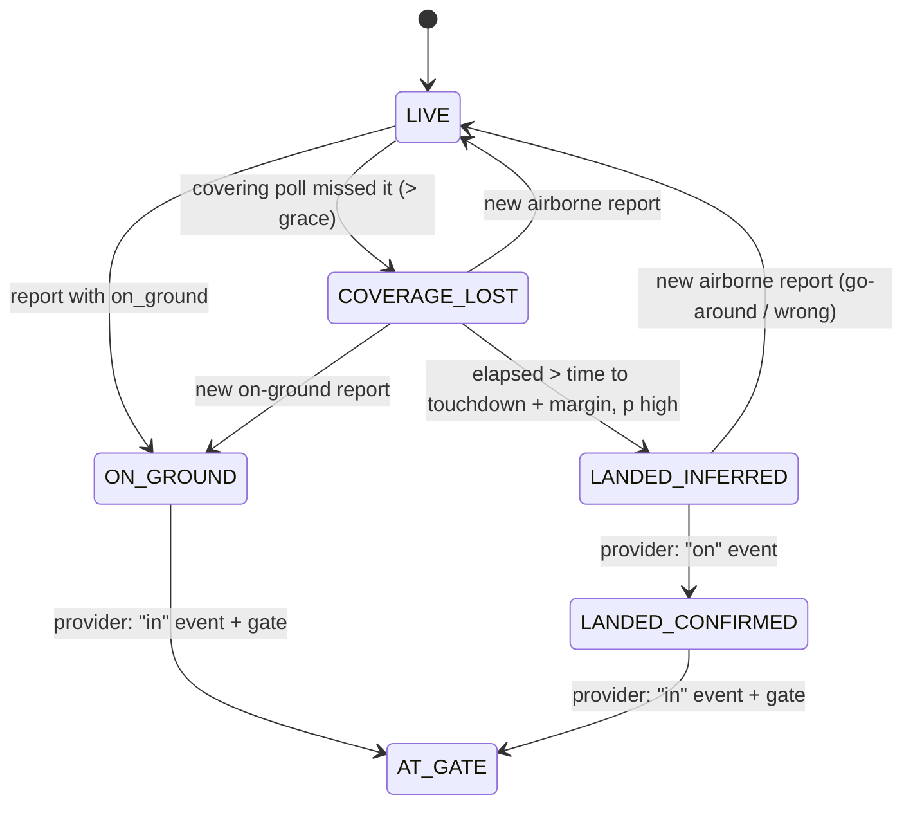

# Coverage-gap inference: progress

This file is the single source of truth for the coverage-gap work: what
"probably landed" becomes when ADS-B coverage is lost. To resume a session,
say "Resume the coverage-gap work from docs/agents/PROGRESS.md". Then read
this file, check the branch state (`git log` on the branches below), and
continue from **Next task**.

## Status

- **Current phase:** 1 (physics estimate, state machine, UI)
- **Next task:** run P1-A, P1-B and P1-D in parallel
- **Blocked on the human:** the Phase 3 provider choice (see `provider-research.md`). Phases 1 and 2 continue meanwhile.
  a checkpoint, and research is running ahead of it.

## Branches and PRs

| Phase | Branch | Based on | PR |
|---|---|---|---|
| 1 | `claude/beautiful-thompson-afahki` | `main` | not opened yet |
| 2 | `claude/coverage-gap-phase2` | phase 1 branch (stacked) | not opened yet |
| 3 | `claude/coverage-gap-phase3` | phase 2 branch (stacked) | not opened yet |

The brief asks for one PR per phase. The later phases build on the earlier
ones, so the branches are stacked, and each PR targets the previous phase's
branch. Never merge to `main`; the human merges.

## Tasks

| ID | Task | Agent | Depends on | Status |
|---|---|---|---|---|
| P0 | Reconnaissance: code map | explorer | none | done |
| P3-R | Research confirmation providers (web): `docs/agents/provider-research.md` | explorer | none | done; awaiting human choice |
| P1-A | Runway data: bundled `runways.tsv`, `runway` table, seed, in-memory `RunwayIndex` | implementer | none | todo |
| P1-B | Pure `CoverageGapEstimator` (Kalman/dead reckoning, runway match, time to touchdown, landed probability) and scenario unit tests | implementer | none | todo |
| P1-C | Backend wiring: poll-coverage tracker, `EstimatorAgent` on the new estimator, `TrackStatus` on `LiveAircraft`, `GET /api/flights/{icao24}/status`, dossier text | implementer | P1-A, P1-B | todo |
| P1-D | Frontend: status line with confidence and source, uncertainty cone GL layer, status polling, Playwright tests | implementer | contract below | todo |
| P1-R | Review Phase 1: diff, all quality gates, check against the brief | reviewer | P1-C, P1-D | todo |
| P2-* | Training data capture (plan below) | | Phase 1 | todo |
| P3-* | Provider interface, mock provider, upgrade logic (plan below) | | Phase 2 | todo |

## Phase 0 findings (summary)

- **"Probably landed" is not one place.** `AircraftController.describeLikelyStatus`
  builds the text, which is `staleExplanation` on the dossier. `presumedLanded`
  is computed per request: phase DESCENDING or LANDING and silent for more than 30 min.
  The dossier panel shows it after 10 minutes of silence.
- **Why planes freeze.** `EstimatorAgent` takes the destination from the legacy
  `aircraft.destination_*` columns, which are now always null, so
  `EstimatedPositionService` returns no estimate. When there is one, it
  dead-reckons to the destination point and parks there. It has no
  uncertainty, no altitude or vertical rate, and no landing concept.
- **No runway data.** `airports.tsv` (OurAirports, 7 columns) has no runways
  and no elevation. OurAirports `runways.csv` is public domain and reachable.
- **Schema** is `schema.sql`, which runs on every boot. There are no migrations, so new
  tables use `CREATE TABLE IF NOT EXISTS` and nothing uses `ALTER`.
- **Existing partial confirmation.** `OpenSkyFlightsClient.confirmLanded` and
  `aircraft.landing_confirmed_at` exist. This becomes the first real provider
  in Phase 3.
- **Wire formats.** The selected plane polls `GET /api/flights/{icao24}/live`
  (a `FlightPosition`) every 72 s. `LiveFrame` (WebSocket) carries marker fields only.
- **Clock.** New code injects `Clock`. `EstimatorAgent` uses `Instant.now()` today.

## Decisions

1. **Coverage lost is measured against polls, not wall time alone.** The
   global sweep refreshes most aircraft only every 6 min, so a silence
   threshold alone would flag every swept aircraft between sweeps.
   `AgentOrchestrator` records each successful poll (time and bounds; the
   global sweep covers the world) in a `PollCoverageTracker`. An aircraft
   is in a gap when a poll that covered its last position completed more
   than `flighttracker.coverage.gap-grace-seconds` (default 60) after its
   last report.
2. **State model.** One enum, `TrackState`, with
   `LIVE, COVERAGE_LOST, LANDED_INFERRED, ON_GROUND, LANDED_CONFIRMED, AT_GATE`.
   Every state also carries a `confidence` (0..1), a `source`
   (`adsb`, `physics`, `model`, or a provider id), and a `sourceKind`
   (`observed`, `inferred` or `confirmed`). Phase 1 produces the first four. The confirmed
   states are reserved for Phase 3. A confirmation is monotonic: a later
   estimate never downgrades it. A new real report resets everything to
   observed states, the same as estimates are cleared today.
3. **Estimator.** A pure function over a fixed snapshot of the last
   reports, the nearby runways, the destination and the current time. While
   an aircraft is silent its inputs don't change, so the snapshot (the last
   ~10 min of positions) is read from `flight_position` once, when the gap
   begins, and cached per `(icao24, observedAt)`. The background estimator
   runs only over aircraft in a gap.
4. **Uncertainty.** The estimator returns an estimated position and a 95%
   radius. The UI draws a cone: the convex hull of the last-seen point and
   the circle around the estimate. After the inferred touchdown, the estimate
   parks on the runway and the radius shrinks to the airport scale.
5. **Transport.** There is a new endpoint, `GET /api/flights/{icao24}/status`
   (contract below). `FlightPosition`, `/live`, `/history`, `LiveFrame` and
   `LiveMarker` stay unchanged. Markers keep using the existing display-position
   mechanism. A coverage-lost plane moves along its dead-reckoned position,
   and an inferred-landed plane is drawn at the runway.
6. **Runway data.** A trimmed OurAirports `runways.tsv` is bundled next to
   `airports.tsv` (only airports in `airports.tsv`, only open runways with
   threshold coordinates). It goes into a new `runway` table and is held in
   memory as a grid-bucketed `RunwayIndex`. The shared record is
   `service/coverage/Runway.java`, one row per landing direction.
7. **Package.** The new backend code goes in `com.flighttracker.service.coverage`.

## Contract: `GET /api/flights/{icao24}/status`

The response is 200 with the JSON below, or 404 when the aircraft is not in the live set.

```json
{
  "icao24": "4ca123",
  "state": "COVERAGE_LOST",
  "confidence": 0.85,
  "source": "physics",
  "sourceKind": "inferred",
  "lastSeenAt": "2026-10-12T11:00:00Z",
  "lastSeenLat": 59.60,
  "lastSeenLon": 17.90,
  "estimate": {
    "lat": 59.65,
    "lon": 17.93,
    "radiusM": 1800,
    "at": "2026-10-12T11:02:00Z",
    "landingProbability": 0.40
  },
  "landing": {
    "airportIcao": "ESSA",
    "runway": "19R",
    "touchdownAt": "2026-10-12T11:03:10Z"
  },
  "gate": null,
  "terminal": null,
  "confirmedAt": null
}
```

- `state` is one of `LIVE | COVERAGE_LOST | LANDED_INFERRED | ON_GROUND | LANDED_CONFIRMED | AT_GATE`.
- `confidence` is the confidence in `state` (0..1). It is null for `LIVE`.
- `source` is `adsb | physics | model | <provider id>`.
- `sourceKind` is `observed | inferred | confirmed`.
- `estimate` is null unless the state is `COVERAGE_LOST` or `LANDED_INFERRED`. `radiusM` is the ~95% horizontal radius, and `at` is the time the estimate was computed.
- `landing` is null when no runway or airport candidate was found. `touchdownAt` is the predicted time while `COVERAGE_LOST`, and the inferred time once `LANDED_INFERRED`.
- `gate`, `terminal` and `confirmedAt` are filled from Phase 3 on (`confirmedAt` is the actual "on" or "in" time).

UI labels (the dossier status line):

| state | label |
|---|---|
| LIVE | (no status line) |
| COVERAGE_LOST | `Coverage lost · est. ±1.8 km` (+ ` · landing ~11:03 ESSA 19R` when `landing`) |
| LANDED_INFERRED | `Landed 92% (inferred) · ESSA 19R` |
| ON_GROUND | `On ground (ADS-B)` |
| LANDED_CONFIRMED | `Landed (confirmed · <source>)` |
| AT_GATE | `At gate B14 (confirmed)` |

The frontend fetches the status when a plane is selected and on every
selected-plane poll. While the state is `COVERAGE_LOST`, it refetches every 15 s,
so the cone grows.



## Phase 2 plan (training data capture)

- Add `CREATE TABLE IF NOT EXISTS track_end_feature` (one compact row per
  track end, keyed `(icao24, last_observed_at)`, with no foreign keys to
  `aircraft` or `flight_position`). It denormalises callsign, origin and destination,
  the last-report kinematics, the runway features, and the estimator output
  and version. Add a `track_end_label` table (outcome, label source, time).
- Capture happens when the estimator first sees a gap (the snapshot is already in
  hand). The label is written when coverage resumes (on ground or airborne)
  or when a provider confirms.
- Retention: `flighttracker.training.retention-days` (default 365), pruned in
  `PositionRetentionService` without touching the 72 h position rule.
- Add a `LandingModel` interface stub (`predict(features) -> Optional<prob>`) that
  the estimator consults. The default no-op bean returns empty.

## Phase 3 plan (confirmation)

- Add a `ConfirmationProvider` interface (`@Component`s collected as a list):
  lookups return OOOI times and gate/terminal with a status enum
  (FOUND/NOT_FOUND/THROTTLED/FAILED). Calls are cached and rate limited
  through `PollBackoff` plus a minimum interval.
- Add a mock provider (disabled by default) and an upgrade service that turns
  inferred or observed states into `LANDED_CONFIRMED`/`AT_GATE` and writes
  the Phase 2 label.
- **Checkpoint:** the human chooses a real provider from the research before
  one is implemented.

## Open questions

- (none yet)

## Log

- 2026-10-12: Phase 0 done. The backend baseline (`mvn verify`) is green.
